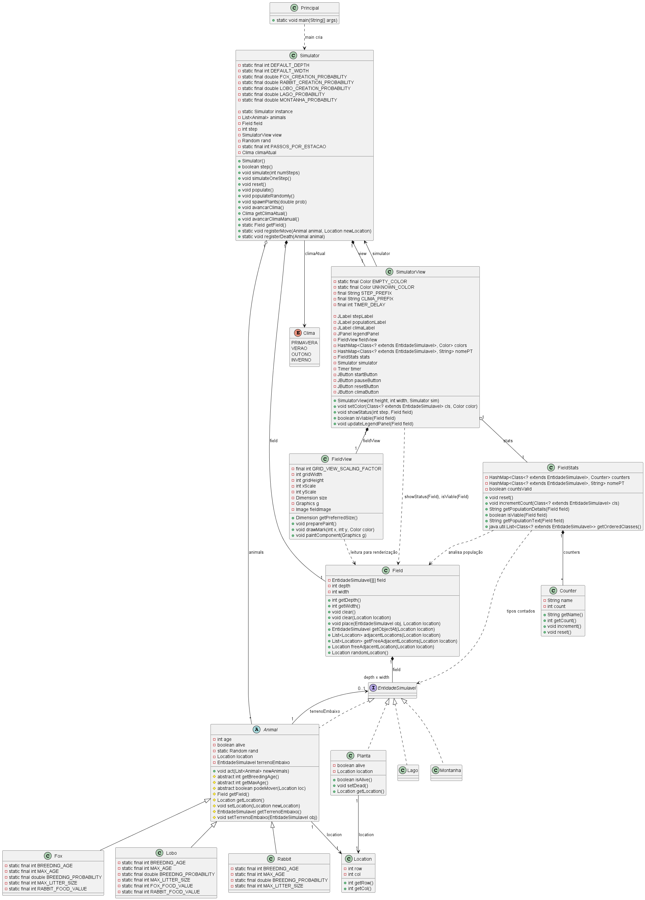

# Ecosystem Simulator | Java

Simulador de ecossistema desenvolvido em **Java**, com interface gráfica utilizando **Swing**. A aplicação representa a interação entre diferentes espécies em um ambiente dinâmico, considerando movimentação, alimentação, reprodução, envelhecimento e condições climáticas.

A simulação utiliza conceitos de programação orientada a objetos para representar as entidades do ecossistema e definir seus comportamentos ao longo do tempo.

> Sobre: Esta é uma versão forkada do projeto desenvolvido em colaboração por [Arthur Soares Marques](https://github.com/ArthurDp78), [João Vitor Givisiez Lessa](https://github.com/joao-givisiez), [Lana Miranda](https://github.com/lanamiranda17) e [Pyetro Augusto Malaquias](https://github.com/Petrus012).
>
> **Repositório original:** [ArthurDp78/ProjetoPPOO](https://github.com/ArthurDp78/ProjetoPPOO).

## Funcionalidades

- **Simulação de ecossistema:** interação entre coelhos, raposas e lobos, com diferentes comportamentos de alimentação, reprodução e sobrevivência.
- **Ciclo de vida:** gerenciamento da idade, nascimento e morte dos animais.
- **Dinâmica predador-presa:** os animais procuram alimento e interagem com outras espécies de acordo com suas regras.
- **Condições climáticas:** alternância entre primavera, verão, outono e inverno, influenciando aspectos da simulação.
- **Vegetação:** crescimento de plantas em posições disponíveis do ambiente.
- **Terreno:** representação de lagos e montanhas, com regras de movimentação específicas para cada espécie.
- **Mapa configurável:** leitura de `mapa.txt` para definir a distribuição inicial dos obstáculos, com geração aleatória alternativa quando o arquivo não está disponível.
- **Interface gráfica:** visualização do ambiente e acompanhamento da evolução da simulação.

## Tecnologias

- **Java:** implementação da lógica e das entidades do simulador.
- **Java Swing:** interface gráfica.
- **Java Collections:** gerenciamento das coleções de animais e outros elementos.
- **Java AWT:** componentes gráficos e representação visual do ambiente.

## Funcionamento

O ambiente é representado por uma grade de posições, na qual as entidades interagem ao longo de sucessivos passos de simulação.

### Espécies e ambiente

| Entidade | Comportamento |
|---|---|
| Coelho | Alimenta-se de plantas e participa da dinâmica de reprodução e sobrevivência |
| Raposa | Atua como predador dos coelhos |
| Lobo | Atua como predador de coelhos e raposas |
| Planta | Representa a vegetação disponível como alimento |
| Lago | Representa uma característica do terreno |
| Montanha | Representa uma característica do terreno |

Cada animal possui atributos e comportamentos próprios, incluindo idade máxima, idade mínima de reprodução e regras de movimentação.

### Ciclo da simulação

A cada passo, o simulador atualiza os animais existentes, considerando seus comportamentos individuais.

O processamento envolve:

1. Atualização do ciclo de vida e das condições de sobrevivência.
2. Busca por alimento e movimentação das espécies.
3. Reprodução e inclusão de novos animais.
4. Remoção de animais mortos.
5. Atualização da representação gráfica do ambiente.

As estações do ano avançam periodicamente e influenciam a disponibilidade de vegetação e determinados comportamentos das espécies.

## Arquitetura

O projeto utiliza herança, abstração e polimorfismo para organizar as responsabilidades das entidades e do motor de simulação.

### Principais classes

| Classe | Responsabilidade |
|---|---|
| `Principal` | Inicialização da aplicação |
| `Simulator` | Controle do estado e dos passos da simulação |
| `SimulatorView` | Representação gráfica do ambiente |
| `Field` | Gerenciamento das posições e entidades do campo |
| `Animal` | Classe abstrata com comportamentos compartilhados pelos animais |
| `Rabbit`, `Fox`, `Lobo` | Implementação dos comportamentos específicos de cada espécie |
| `Planta` | Representação da vegetação |
| `Lago`, `Montanha` | Representação de elementos do terreno |
| `Location` | Representação das coordenadas no campo |
| `Clima` | Enumeração das estações do ano |
| `EntidadeSimulavel` | Interface que identifica entidades admitidas no ambiente |

A classe abstrata `Animal` define operações comuns às espécies, enquanto suas subclasses implementam comportamentos específicos.

O repositório também disponibiliza o diagrama UML utilizado para representar a estrutura das classes e seus relacionamentos.



## Estrutura do Projeto

```text
.
├── src/
│   ├── Principal.java
│   ├── Simulator.java
│   ├── SimulatorView.java
│   ├── Animal.java
│   ├── Rabbit.java
│   ├── Fox.java
│   ├── Lobo.java
│   ├── Planta.java
│   ├── Lago.java
│   ├── Montanha.java
│   ├── Clima.java
│   ├── Field.java
│   ├── FieldStats.java
│   ├── Location.java
│   └── ...
├── mapa.txt
├── diagrama.png
├── diagrama.uml
└── README.md
```

## Como Executar

### Pré-requisitos

- JDK instalado
- Ambiente com suporte a interface gráfica

### 1. Clonar o repositório

```bash
git clone https://github.com/lanamiranda17/ecosystem-simulator-java.git
cd ecosystem-simulator-java
```

### 2. Compilar

Na raiz do projeto, execute:

```bash
mkdir -p bin
javac -d bin src/*.java
```

### 3. Iniciar a simulação

```bash
java -cp bin Principal
```

A aplicação abrirá a interface gráfica do simulador.

O arquivo `mapa.txt`, localizado na raiz do projeto, é utilizado para configurar elementos do ambiente. Caso não esteja disponível, o simulador utiliza uma distribuição inicial aleatória.

## Contexto

Projeto desenvolvido na disciplina **GAC106 — Práticas de Programação Orientada a Objetos**, da Universidade Federal de Lavras (UFLA).

**Desenvolvedores:**
- Arthur Soares Marques
- João Vitor Givisiez Lessa
- Lana da Silva Miranda
- Pyetro Augusto Malaquias
